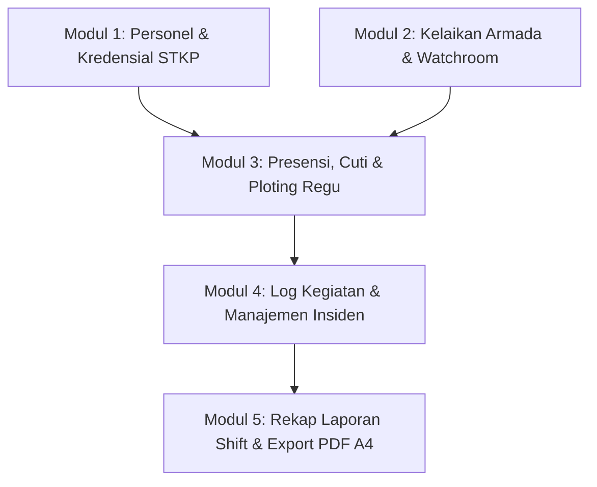

# ACMS — ARFF Command & Monitoring System
**Sistem Terintegrasi Monitoring Operasional, Personel, Kesiapan Armada & Pelaporan Dinas**  
**Airport Rescue & Fire Fighting (ARFF) Section • Bandar Udara Internasional Yogyakarta (YIA / WAHI - Kategori 8)**

---

## 📌 1. Latar Belakang & Tujuan
Operasional ARFF menuntut kesiapsiagaan tinggi, respons cepat (*rapid response time* < 180 detik sesuai standar ICAO), dan akuntabilitas data dinas. **ACMS (ARFF Command & Monitoring System)** dirancang untuk menyatukan seluruh mata rantai administrasi dan komando lapangan dalam satu platform digital terpadu:
1. **Pengelolaan Database & Kredensial Personel**: Monitoring masa berlaku lisensi STKP (*Basic*, *Junior*, *Senior*) dan pejabat struktural.
2. **Kesiapan Armada & Posko Komunikasi**: Monitoring status kelaikan fisik (*Serviceable* vs *Unserviceable*) dan pencatatan fasilitas Watchroom.
3. **Presensi Dinas & Ploting Regu**: Pengaturan distribusi kru shift pada unit kendaraan operasional dengan proteksi anti-tabrakan penugasan (*auto-eviction* bagi personel izin/cuti).
4. **Logbook Dinamika Operasional**: Pencatatan kegiatan berkala (8 Kategori Baku) dan pelaporan insiden darurat airside (10 Klasifikasi Baku ARFF).
5. **Rekapitulasi Laporan Dinas Otomatis**: Generator dokumen cetak resmi PDF format A4 dengan kop surat PT Angkasa Pura Indonesia Kantor Cabang YIA dan penandatanganan dinamis.

---

## 🏢 2. Arsitektur & Modul Sistem

Sistem terdiri dari 5 modul fungsional utama yang saling terhubung:



### Modul 1: Personnel Management & Credential
- **Master Data 4 Regu Dinas**: Katalog terfokus 100% pada 4 regu dinas operasional (*Alpha, Bravo, Charlie, Delta*).
- **Kredensial Lisensi STKP**: Validasi ENUM lisensi resmi (`Basic`, `Junior`, `Senior`) beserta nomor lisensi dan tanggal kadaluarsa.
- **Akses Profil Mandiri (Rule 9)**: Akses profil seragam melalui avatar di Header Top App Bar untuk pembaruan data dan kata sandi mandiri.
- **Pejabat Struktural Dinamis**: Pengangkatan dinamis pimpinan unit (Department Head, Section Head, dan 4 Ketua Regu) tanpa hardcode data.

### Modul 2: Fleet Readiness & Watchroom Facility
- **Status Kelaikan Operasional Murni**: Pilihan baku status kendaraan: **`Serviceable`** (siap operasi penuh) atau **`Unserviceable`** (kendala/dalam perbaikan).
- **Status Default**: Kendaraan yang belum diperiksa oleh PIC pada shift berjalan otomatis berstatus **"Belum Dilaporkan"**.
- **Justifikasi & Audit Trail**: Wajib menyertakan catatan rincian kendala jika unserviceable, catatan tindak lanjut saat pemulihan status, serta dokumentasi foto berformat WebP.
- **Kesiapan Watchroom**: Checklist kesiapan perangkat komunikasi radio ground-to-air, sirine crash bell, dan sistem komputer pemantau.

### Modul 3: Shift Roster, Deployment & Leave Management
- **Rotasi Otomatis 4 Regu**: Algoritma roster 8 hari siklus dinas (Pagi, Siang, Malam, Libur/Off) dengan dukungan kustomisasi tanggal acuan (*anchor date*).
- **Manajemen Izin & Cuti**: Pengajuan cuti tahunan, sakit, izin dinas, dan tukar dinas.
- **Integritas Penugasan (*Auto-Eviction*)**: Personel yang sedang izin/cuti otomatis diblokir dari slot penugasan kendaraan agar tidak memicu error tabrakan data ganda.
- **Proteksi Hak Akses Shift**: Halaman ploting hanya dapat diubah oleh regu dinas yang bertugas aktif pada shift tersebut (*"Bukan Shift Anda"*).
- **Umpan Balik Visual Instan**: Feedback notifikasi melayang (*fixed floating toast*) dengan auto-dismiss 3 detik pada setiap aksi simpan ploting.

### Modul 4: Daily Logbook & Incident Reporting
- **8 Kategori Baku Kegiatan ARFF YIA**:
  1. `serah_terima` (Serah Terima Shift)
  2. `apel_briefing` (Apel & Briefing Dinas)
  3. `periksa_armada` (Pemeriksaan Kendaraan & Uji Pancar)
  4. `periksa_peralatan` (Pemeriksaan Alat Operasional & Rescue)
  5. `latihan_drill` (Latihan Fisik & Drill Basah/Kering)
  6. `pemeliharaan` (Pemeliharaan Fasilitas & Kendaraan)
  7. `sosialisasi_keselamatan` (Edukasi & Inspeksi Runway/Apron)
  8. `catatan_kendala` (Catatan Khusus & Hambatan Dinas)
- **10 Klasifikasi Baku Kejadian ARFF**: Pelaporan insiden darurat berstandar ICAO (*Aircraft Accident, Aircraft Incident, Full Emergency, Local Standby, Fuel Spill, Structure Fire, Bomb Threat, Hazmat Incident, Medical Emergency, Wildlife Hazard*).
- **Zero Orphaned Files**: Otomatisasi pembersihan berkas fisik di server saat dokumentasi kegiatan dihapus.

### Modul 5: Executive Shift Report & Official PDF A4 Generator
- **Agregasi Data Multi-Sumber**: Menggabungkan data kelaikan armada, audit trail bawaan shift lalu, ploting formasi kru, logbook kegiatan dinas, dan catatan insiden.
- **Standar Dokumen Cetak Resmi**:
  - Kop surat resmi: **PT ANGKASA PURA INDONESIA • KANTOR CABANG BANDARA INTERNASIONAL YOGYAKARTA (YIA) • AIRPORT RESCUE & FIRE FIGHTING (ARFF) SECTION • KODE WAHI • KATEGORI 8**.
  - Nomor dokumen dinamis: `DSR/ARFF-YIA/{YYYYMMDD}/S{SHIFT}`.
  - Penandatangan dinamis: Nama dan NIP Department Head dan Ketua Regu dinas yang bertugas ditarik dari database, dilengkapi tanda tangan digital resmi.
  - Transparansi presensi: Mencantumkan tabel daftar nama personel yang izin/cuti.

---

## 💻 3. Teknologi yang Digunakan

### Frontend
- **Framework & Tooling**: [React 18](https://react.dev/), [Vite 5](https://vitejs.dev/)
- **Styling**: [Tailwind CSS 3](https://tailwindcss.com/) (dengan kepatuhan ketat performa anti-lag form INP/LCP)
- **Komponen Ikon**: [Lucide React](https://lucide.dev/)
- **HTTP Client**: [Axios](https://axios-http.com/)
- **Optimasi Gambar**: Kompresi canvas client-side ke format WebP

### Backend
- **Runtime & Environment**: [Node.js](https://nodejs.org/) (ES Modules)
- **Web Framework**: [Express.js](https://expressjs.com/)
- **Database Driver**: [mysql2/promise](https://github.com/sidorares/node-mysql2)
- **Autentikasi & Keamanan**: JSON Web Token ([jsonwebtoken](https://github.com/auth0/node-jsonwebtoken)), [bcryptjs](https://github.com/dcodeIO/bcrypt.js)
- **Penanganan Berkas**: [Multer](https://github.com/expressjs/multer)
- **Mesin Generator Dokumen**: [PDFKit](https://pdfkit.org/)

---

## 📂 4. Struktur Direktori Proyek

```text
acms/
├── backend/
│   ├── src/
│   │   ├── config/             # Konfigurasi database & skema SQL baku (schema.sql)
│   │   ├── controllers/        # Business logic kontroler API (auth, personnel, readiness, deployment, dll)
│   │   ├── middleware/         # Autentikasi JWT, validasi role, & upload middleware
│   │   ├── routes/             # Definisi rute endpoint RESTful API
│   │   ├── services/           # Generator dokumen PDF A4 (pdfService.js)
│   │   ├── utils/              # Helper manipulasi tanggal & waktu
│   │   └── server.js           # Titik masuk utama server Express
│   ├── uploads/                # Direktori penyimpanan aset dokumen & foto bukti fisik
│   ├── .env                    # Variabel konfigurasi lingkungan backend
│   └── package.json
├── frontend/
│   ├── src/
│   │   ├── components/         # Komponen UI modular (common, forms, layout, mobile)
│   │   ├── context/            # AuthContext untuk manajemen sesi login & shift aktif
│   │   ├── pages/              # Halaman antarmuka desktop & mobile
│   │   ├── services/           # Interceptor Axios API
│   │   ├── utils/              # Helper kompresi WebP & formatting tanggal dinas
│   │   ├── App.jsx             # Router navigasi utama
│   │   └── main.jsx
│   ├── public/                 # Aset statis & logo resmi
│   └── package.json
├── masak/                      # Sandbox khusus: skrip uji coba, manipulasi data & tes integrasi
├── GEMINI.md                   # Aturan baku, konfigurasi keamanan & lessons learned proyek
└── README.md                   # Dokumentasi teknis sistem
```

---

## 🚀 5. Panduan Instalasi & Menjalankan Sistem

### Prasyarat Sistem
- **Node.js**: Versi `>= 18.0.0`
- **NPM**: Versi `>= 9.0.0`
- **Database**: MySQL Server versi `>= 8.0` atau MariaDB `>= 10.4`

### 1. Kloning Repositori & Persiapan Direktori
```bash
git clone <url-repositori-acms>
cd acms
```

### 2. Konfigurasi Backend & Database
1. Buka berkas `backend/.env` dan sesuaikan kredensial database Anda:
   ```env
   PORT=5000
   NODE_ENV=development
   DB_HOST=localhost
   DB_USER=root
   DB_PASSWORD=
   DB_NAME=logbuk
   DB_PORT=3306
   JWT_SECRET=super_secret_jwt_key_arff_operations_2026
   JWT_EXPIRES_IN=24h
   UPLOAD_PATH=uploads
   ```
2. Inisialisasi struktur tabel database menggunakan skema baku:
   ```bash
   mysql -u root -p logbuk < backend/src/config/schema.sql
   ```
3. Pasang dependensi dan jalankan server backend:
   ```bash
   cd backend
   npm install
   npm run dev
   ```
   *Server backend akan aktif di `http://localhost:5000`.*

### 3. Konfigurasi & Menjalankan Frontend
1. Buka terminal baru dan masuk ke direktori frontend:
   ```bash
   cd frontend
   npm install
   npm run dev
   ```
   *Aplikasi web akan aktif di `http://localhost:5173`.*

---

## 🔐 6. Hak Akses & Kredensial Pengguna

Sistem membedakan alur pengguna ke dalam 3 hierarki peran:
1. **Administrator Sistem (`role: admin`)**:
   - Memiliki akses menyeluruh ke kelola master personel, kelola pejabat penandatangan, pengaturan siklus jadwal, dan rekapitulasi laporan dinas.
   - Diarahkan langsung ke antarmuka desktop.
2. **Ketua Regu / Chief (`role: chief` / `supervisor`)**:
   - Memimpin operasional shift berjalan, menyusun formasi ploting armada, memvalidasi kelaikan posko, dan menandatangani laporan dinas shift.
   - Diarahkan langsung ke antarmuka dinas mobile.
3. **Kru / Pelaksana Lapangan (`role: junior_firefighter`, `firefighter`, PIC)**:
   - Mengisi laporan kelaikan kendaraan yang menjadi tanggung jawabnya (PIC), melihat penugasan diri, dan mengajukan cuti mandiri.

---

## 🛡️ 7. Standar Pengembangan & Integritas Data

- **Folder Sandbox Kerja (`masak/`)**: Seluruh pengujian ad-hoc, simulasi integrasi alur berantai, dan skrip uji mandiri ditempatkan secara eksklusif di dalam folder `masak/` (diabaikan oleh `.gitignore`). Dilarang keras membuat folder `tests/` di direktori produksi.
- **Zero Dummy Data**: Seluruh nama personel, unit armada, dan pejabat operasional ditarik secara dinamis dari database tanpa data tiruan (*anti-AI-slop*).
- **Zero Hardcode Pejabat**: Nama Department Head dan Ketua Regu tidak di-hardcode di kode program, melainkan dievaluasi dinamis sesuai shift yang aktif.
- **Performa Input Form**: Elemen form input bebas dari CSS `transition-all` atau filter blur berat untuk menjamin responsivitas instan (<16ms).

---

## 📄 8. Lisensi
Hak Cipta © 2026 **Airport Rescue and Fire Fighting (ARFF) Section — Bandara Internasional Yogyakarta (YIA)**. Seluruh hak cipta dilindungi undang-undang.
